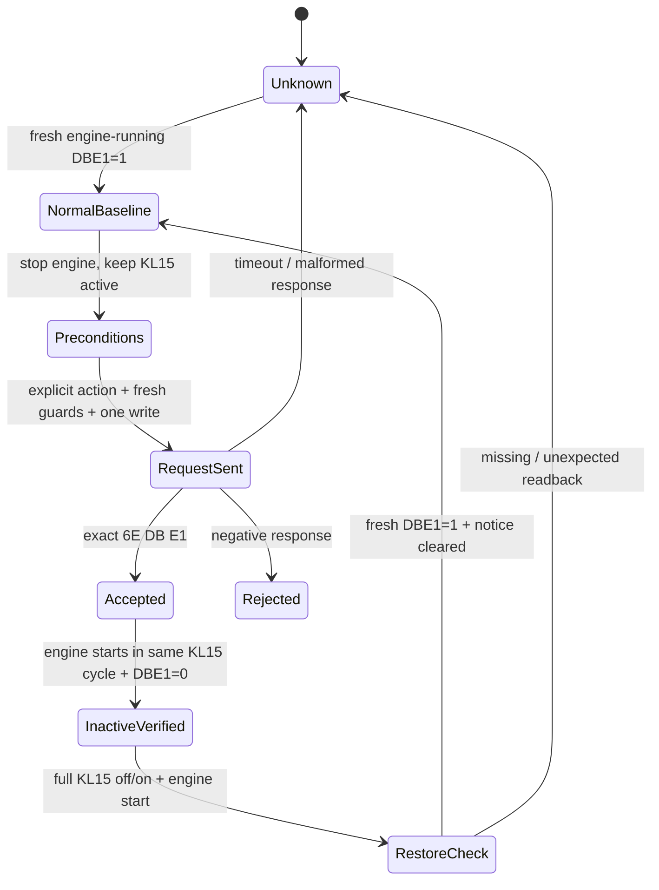

# Protocol reference

## Scope and transport

Requests shown here are UDS application payloads sent using a suitable diagnostic transport. BMW logical addresses `0x29` (DSC), `0x19` (LMV), `0x18` (EGS), and `0x40` (BDC) are **not CAN arbitration IDs**. No ENET framing, routing activation, credential material, or security-access bypass is supplied.

The tested mode is temporary for the current terminal-15 cycle. The write is to the DSC's function flag; it is not a flash or persistent coding operation.

## Relevant reads

| ECU | UDS request | Meaning / example |
| --- | --- | --- |
| DSC / other ECUs | `22 F1 50` | SGBD identification; compare complete raw responses |
| DSC | `22 DB E1` | `LMV_FUNKTION`: `62 DB E1 01` active; `62 DB E1 00` inactive |
| BDC | `22 DC 56` | Tested terminal-state response with KL15 active: `62 DC 56 0A`; do not generalize this encoding without a matched definition |
| LMV | `22 DB 32` | Front-axle requested torque and ECU-estimated actual torque; not direct wheel torque |
| LMV | `22 DF EA` | Transfer-case status qualifiers; no useful mode distinction established in the test |
| DSC / LMV | `19 02 0D` | DTCs matching testFailed/pending/confirmed status mask; handle response-pending correctly |

Read speed, wheel speeds, selector, parking brake, accelerator and RPM using independently verified definitions for the actual ECU variant. This repository deliberately does not invent portable scaling rules or guard DIDs for unmatched variants.

## One-shot state machine

- `ENGINE OFF`: never display “2WD” merely because off-engine `DBE1=0`.
- `ACCEPTED`: positive acknowledgement alone does not prove the running-engine condition.
- `INACTIVE VERIFIED`: describes the diagnostic flag, not a proven mechanical disconnect.
- `UNKNOWN`: stop issuing writes; obtain fresh reads and use the tested restoration path as appropriate.

## Failure handling

- Exact positive response to `2E DB E1 00`: `6E DB E1`.
- A negative response is not success. For example, `7F 2E 33` is a security-access-denied response, not proof of a particular engine-state error. Do not attempt a bypass or change ECUs automatically.
- A timeout or lost response is an uncertain outcome. Never auto-retry the write.
- `7F 19 78` is response-pending for a DTC request: wait according to the diagnostic session timing. A short local timeout is not evidence of an empty DTC list.
- The tested restoration is a full terminal-15 cycle. Engine stop/start alone can leave terminal 15 active and is not an equivalent restoration test.
- No `2E DB E1 01`, `11 02`, VIP write, DSC disable, fault clearing, or persistent coding step is included in this procedure.

If the running-engine baseline fails to return, retain raw diagnostic responses and investigate the actual fault. Do not report the car as restored based only on a timer or an engine-off zero-torque reading.
